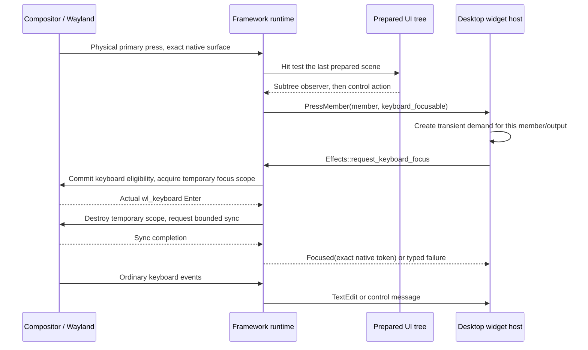

# Keyboard focus: intent, native ownership and painting

A text box can remember its caret while another application receives the
keyboard. Lucent keeps those facts separate. This guide follows the proposed
one-shot focus API in source `ba5b8a51f960`; native acceptance is pending.

## Four different states

| State | Owner | Meaning |
| --- | --- | --- |
| Capability | Client widget catalog | This widget contains keyboard controls. Capability alone requests no focus. |
| User demand | Client `widgets::keyboard_demand::Demand` | A genuine press selected a focusable member on one output. Demand is transient, never a saved preference. |
| Native ownership | Wayland runtime | A real keyboard Enter was observed for one exact native surface lifetime. Leave, removal or seat loss ends ownership. |
| Logical selection and caret | Framework `Interaction` and client field state | Which control is selected and where editing would resume. Losing native ownership need not erase it. |

`Keyboard::OnDemand` expresses eligibility. It does not mean the compositor has
given the surface a keyboard. A frame submission also does not prove keyboard
ownership.

The distinction matters when several widgets share a native surface. A passive
clock must not request keys merely because its surface also contains media
buttons. The actual pressed control supplies the intent.

## From one press to editing



The prepared hit carries `keyboard_focusable`; the runtime does not infer it
from whichever field happened to be selected earlier. The nearest
`Element::on_pointer_press` observer receives its message before the control's
ordinary action. That lets the host establish demand before editing starts.
Drag capture keeps its existing lifetime and routing.

The client describes the desired surface policy and issues a generic effect:

```rust,ignore
effects.request_keyboard_focus(address, cancellation, move |outcome| {
    Message::KeyboardResolved(request_id, outcome)
});
```

This is an API excerpt, not a complete application. The client retains the
request identity, cancellation and exact target. A completion from an earlier
request cannot grant a later request ownership.

## What happens underneath

`lucent-wayland` validates that the effect belongs to the current real primary
press, a focusable prepared hit, an ordinary opted-in client and the same native
surface lifetime. A socket command cannot manufacture that authority. Secure
lock and login clients remain opted out.

The backend can use the compositor's optional
`hyprland_focus_grab_manager_v1` protocol. The public API exposes no Hyprland
objects. Unsupported compositors return a typed unavailable outcome.

When eligibility needs changing, a keyboard-only commit preserves the last
successfully presented geometry, scale, viewport and input regions. It does not
commit an unrelated pending resize or claim a new rendered frame. Acquiring keys
therefore does not wait for a GPU image to become available.

The temporary native focus scope is destroyed after real Enter. A bounded
`wl_display.sync` then checks that the same surface remains eligible and focused
after that teardown. Only then does the request report `Focused(token)`.
If teardown loses focus, it reports `NotRetained`. The implementation neither
pulses exclusive keyboard policy nor promotes the surface's layer.

The scope is not held throughout editing. Keeping it alive could make an inline
widget behave like a modal popup and interfere with clicks elsewhere. Native
first-click typing and the first outside click still require compositor tests.
Focus after teardown depends on compositor policy; a successful request cannot
promise future global ownership.

## Losing focus and repainting

`Event::KeyboardFocus` carries Entered, Left, Retired or Unavailable for an opaque
native lifetime token. The client clears acknowledged demand on matching loss;
old native events cannot clear a replacement owner's demand. Opening a
foreground shell panel clears widget intent. Closing that panel does not
recreate it.

The framework's native keyboard-active state controls the caret, selection and
keyboard-focus paint. Logical focus, selection offsets, scrolling and hover
survive independently. A native ownership change invalidates the affected
surface and normal frame scheduling repaints it. Vulkan draws the resulting
scene; Vulkan does not choose focus or route key presses.

The runtime also rejects key dispatch once the client withdraws keyboard
eligibility, even if compositor Leave has not arrived yet. Pending requests
have a two-second dispatch deadline and bounded native cleanup. Cancellation,
native retirement and seat removal cannot complete an obsolete request as
focused.

## Where to read the implementation

Paths below are relative to `lucent/`:

| Layer | Source | Responsibility |
| --- | --- | --- |
| Framework contract | `crates/lucent-api/src/keyboard_focus.rs` | Request, typed outcome, cancellation and opaque lifetime identity. |
| Prepared input | `crates/lucent-ui/src/press_observation.rs` | Nearest subtree observation and actual hit capability. |
| Native backend | `crates/lucent-wayland/src/focus_request.rs` | Admission, optional native protocol, teardown verification and lifecycle. |
| Native commits | `crates/lucent-wayland/src/keyboard_control.rs` | Preserve presented geometry while updating eligibility. |
| Native painting state | `crates/lucent-ui/src/focus_presentation.rs` | Keyboard-active paint without destroying logical editing state. |
| Client policy | `apps/lucent-desktop/src/widgets/keyboard_demand.rs` | Member/output demand, request ownership and stale-result rejection. |
| Composition | `apps/lucent-desktop/src/desktop.rs` | Foreground policy and routing between widget hosts and runtime. |

This feature belongs to the presentation framework and client. Domain service
contracts remain **ports**, and operating-system implementations remain
**adapters**. Neither needs native keyboard objects. Notification URI opening
continues to use `UriPort`; widget focus acquisition does not invoke that port.

## What the existing VM evidence establishes

The [source b2 native report](../reports/measurements/lucent-cold-default-uri-b2.json)
records pointer success and Tab/Enter failure, with all nine cleanup checks
passing in each case. It observes Clock regaining native keyboard focus after
notification history closes; the browser document then lacks focus. Clock and
Calendar had actually committed `None` while history was open, so that run does
not support a missed-demotion explanation.

That report predates this new demand/acquisition implementation. Authored
regressions, successful compilation, visual captures, native interaction and
performance acceptance are separate checks. In particular, the new source must
pass immediate first-key delivery, an ordinary first outside click, canonical
pointer and Tab/Enter URI opening, and secure-session regression tests before
this focus fix is accepted.
