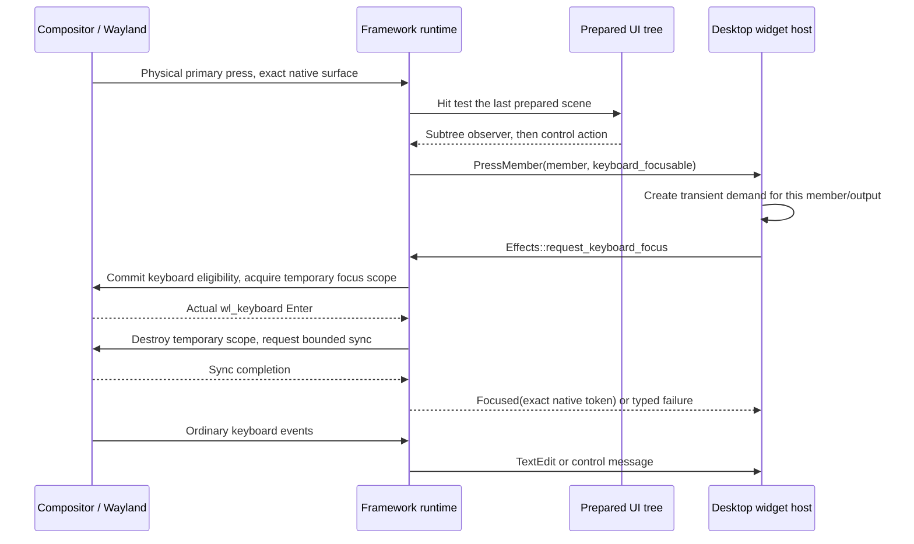

# Keyboard focus: intent, native ownership and painting

A text box can remember its caret while another application receives the
keyboard. Lucent keeps those facts separate. This guide follows the implemented
one-shot focus API in compiled and deployed candidate `ba5b8a51f960`.
The original canonical cold URI interaction now passes in its recorded scope;
inline-widget and secure-session acceptance remain separate.

## Four different states

| State | Owner | Meaning |
| --- | --- | --- |
| Capability | Client widget catalog | This widget contains keyboard controls. Capability alone requests no focus. |
| User demand | Client `widgets::keyboard_demand::Demand` | A genuine press selected a focusable member on one output. Demand is transient, never a saved preference. |
| Native ownership | Wayland runtime | A real keyboard Enter was observed for one exact native surface lifetime. Leave, removal or seat loss ends ownership. |
| Logical selection and caret | Framework `Interaction` and client field state | Which control is selected and where editing would resume. Losing native ownership need not erase it. |

`Keyboard::OnDemand` expresses eligibility. It does not mean the compositor has
given the surface a keyboard. A frame submission also does not prove keyboard
ownership.

The distinction matters when several widgets share a native surface. A passive
clock must not request keys merely because its surface also contains media
buttons. The actual pressed control supplies the intent.

## From one press to editing



The prepared hit carries `keyboard_focusable`; the runtime does not infer it
from whichever field happened to be selected earlier. The nearest
`Element::on_pointer_press` observer receives its message before the control's
ordinary action. That lets the host establish demand before editing starts.
Drag capture keeps its existing lifetime and routing.

The client describes the desired surface policy and issues a generic effect:

```rust,ignore
effects.request_keyboard_focus(address, cancellation, move |outcome| {
    Message::KeyboardResolved(request_id, outcome)
});
```

This is an API excerpt, not a complete application. The client retains the
request identity, cancellation and exact target. A completion from an earlier
request cannot grant a later request ownership.

## What happens underneath

`lucent-wayland` validates that the effect belongs to the current real primary
press, a focusable prepared hit, an ordinary opted-in client and the same native
surface lifetime. A socket command cannot manufacture that authority. Secure
lock and login clients remain opted out.

The backend can use the compositor's optional
`hyprland_focus_grab_manager_v1` protocol. The public API exposes no Hyprland
objects. Unsupported compositors return a typed unavailable outcome.

When eligibility needs changing, a keyboard-only commit preserves the last
successfully presented geometry, scale, viewport and input regions. It does not
commit an unrelated pending resize or claim a new rendered frame. Acquiring keys
therefore does not wait for a GPU image to become available.

The temporary native focus scope is destroyed after real Enter. A bounded
`wl_display.sync` then checks that the same surface remains eligible and focused
after that teardown. Only then does the request report `Focused(token)`.
If teardown loses focus, it reports `NotRetained`. The implementation neither
pulses exclusive keyboard policy nor promotes the surface's layer.

The scope is not held throughout editing. Keeping it alive could make an inline
widget behave like a modal popup and interfere with clicks elsewhere. Native
first-click typing and the first outside click still require compositor tests.
Focus after teardown depends on compositor policy; a successful request cannot
promise future global ownership.

## Losing focus and repainting

`Event::KeyboardFocus` carries Entered, Left, Retired or Unavailable for an opaque
native lifetime token. The client clears acknowledged demand on matching loss;
old native events cannot clear a replacement owner's demand. Opening a
foreground shell panel clears widget intent. Closing that panel does not
recreate it.

The framework's native keyboard-active state controls the caret, selection and
keyboard-focus paint. Logical focus, selection offsets, scrolling and hover
survive independently. A native ownership change invalidates the affected
surface and normal frame scheduling repaints it. Vulkan draws the resulting
scene; Vulkan does not choose focus or route key presses.

The runtime also rejects key dispatch once the client withdraws keyboard
eligibility, even if compositor Leave has not arrived yet. Pending requests
have a two-second dispatch deadline and bounded native cleanup. Cancellation,
native retirement and seat removal cannot complete an obsolete request as
focused.

## Where to read the implementation

Paths below are relative to `lucent/`:

| Layer | Source | Responsibility |
| --- | --- | --- |
| Framework contract | `crates/lucent-api/src/keyboard_focus.rs` | Request, typed outcome, cancellation and opaque lifetime identity. |
| Prepared input | `crates/lucent-ui/src/press_observation.rs` | Nearest subtree observation and actual hit capability. |
| Native backend | `crates/lucent-wayland/src/focus_request.rs` | Admission, optional native protocol, teardown verification and lifecycle. |
| Native commits | `crates/lucent-wayland/src/keyboard_control.rs` | Preserve presented geometry while updating eligibility. |
| Native painting state | `crates/lucent-ui/src/focus_presentation.rs` | Keyboard-active paint without destroying logical editing state. |
| Client policy | `apps/lucent-desktop/src/widgets/keyboard_demand.rs` | Member/output demand, request ownership and stale-result rejection. |
| Composition | `apps/lucent-desktop/src/desktop.rs` | Foreground policy and routing between widget hosts and runtime. |

This feature belongs to the presentation framework and client. Domain service
contracts remain **ports**, and operating-system implementations remain
**adapters**. Neither needs native keyboard objects. Notification URI opening
continues to use `UriPort`; widget focus acquisition does not invoke that port.

## What the existing VM evidence establishes

The [source b2 native report](../reports/measurements/lucent-cold-default-uri-b2.json)
records pointer success and Tab/Enter failure, with all nine cleanup checks
passing in each case. It observes Clock regaining native keyboard focus after
notification history closes; the browser document then lacks focus. Clock and
Calendar had actually committed `None` while history was open, so that run does
not support a missed-demotion explanation.

That report predates this new demand/acquisition implementation. Authored
regressions, successful compilation, visual captures, native interaction and
performance acceptance are separate checks. In particular, the new source must
pass immediate first-key delivery, an ordinary first outside click, canonical
pointer and Tab/Enter URI opening, and secure-session regression tests before
this focus fix is accepted.


### Source qualification and coherent candidate deployment

Source `ba5b8a51f960` passes its full Ubuntu Rust, controlled service-protocol
and software-Vulkan regression job in
[CI40428709862](https://github.com/xandreeddev/desktop-lab/actions/runs/40428709862).
The later [Arch40430392734 job](https://github.com/xandreeddev/desktop-lab/actions/runs/40430392734)
passes all 17 qualification stages, 880 targeted tests and 94 required named
regressions. Its subsequent fresh-memory admission refuses the catalogue export;
no capture export or release archive is produced. The rejected sample was not
recorded, so host pressure versus cgroup cache cannot be inferred from that run.
That failed workflow remains a historical result; it produced neither a native
fix nor a new catalogue or deployment.

The corrected [Arch40433468095 run](https://github.com/xandreeddev/desktop-lab/actions/runs/40433468095)
passes the same 17 stages, 880 tests and 94 named regressions. After verifying
all copied payload hashes, it removes only its freshly owned private Cargo
target. Recorded effective available memory rises from 3,795 to 6,402 MiB;
three fresh capture admissions pass at 6,402 MiB with the unchanged 4,500 MiB
floor. These are hosted build facts, not desktop memory acceptance or proof of
the earlier unrecorded failure cause.

The actual llvmpipe CPU-Vulkan export passes strict validation of 121 producers
and 480 captures. Concrete target ELF/header review and coherent six-client/
root-greeter deployment also pass, with settings/security preserved and no
greetd restart. The [source-specific release report](../reports/measurements/lucent-keyboard-intent-ba5-release.json)
keeps original archive flags separate from the later deployment receipt.

The first Notes controller attempt fails before any typing or feature check;
all nine restoration checks pass, including its expected guarded restart.
This is a harness failure, not a passed or failed native focus result. A fresh
normal identity must be bound before another attempt. Later V4–V6 failures retain
their original outcomes and cleanup results; their combined down/up QMP call did
not publish a pressed USB report.
A separately rebound original [canonical cold URI trial](../reports/measurements/lucent-cold-default-uri-ba5.json)
now passes both pointer and Tab/Enter routes. Each fresh owned document receives
one trusted, unmodified, nonrepeat `KeyA`; each case passes all three feature and
nine cleanup checks, without forced focus, prewarming or a cursor workaround.
That closes only this controlled URI workflow on one FHD virtual output.
Source tests, offscreen pictures and installation alone do not accept interactions;
first-click widget and secure-session results require their own evidence.

### Corrected pointer transport and first-key timing

The [V7 native trial](../reports/measurements/lucent-widget-first-key-ba5.json)
sends DOWN and UP in separate QMP synchronizations, with `KeyA` immediately after
DOWN and balanced UP before diagnostic reads. There is no focus command, wait or
retry. Notes gains logical focus and one native Enter with requested/committed
`OnDemand`, but the first trusted nonrepeat key reaches the owned browser and
Notes remains unchanged. The host down-to-key transport interval is 31.625 ms.
All nine restoration checks pass; outside-click and reacquisition are unattempted.

These sequential checkpoints do not measure callback entry, socket flush, server
processing or the exact Enter/KeyA dispatch order. Missing timing, keyboard-active
state and completed request outcomes remain unavailable. The proposed nonblocking
flush of the complete native control transaction removes a possible queue-drain
delay; it grants no focus and is not a verified fix. A newly compiled runtime and
the corrected native trial are required. The original cold URI workflow remains
accepted in its separate recorded scope.

The additional [V8 trial](../reports/measurements/lucent-widget-completed-click-ba5.json)
completes DOWN and UP in separate synchronizations before immediate KeyA, with no
focus wait or retry. It also fails first-key delivery at a 66.634 ms host interval
from DOWN start, including UP transport. Notes gains logical/native focus, while
the owned browser receives the key; all nine restorations pass. Outside-click
and reacquisition remain unattempted. This case does not overwrite V7's failure.

The [V1 lock trial](../reports/measurements/lucent-native-lock-ba5.json) retains its
exit-status assertion failure. V2 refuses before lock/password because systemd
serializes an initially null InvocationID as an empty array. The new
[V3 regression](../reports/measurements/lucent-native-lock-ba5-v3.json) passes all
six checks using one private unit reference: live nonzero invocation identity,
exact native PID and positive start are retained through normal status0 exit.
The same connection observes compositor lock acknowledgement and authenticated
unlock; references and original state are preserved. No default Code0 is accepted
as exit proof. This accepts the recorded lock/PAM cycle, not login, secure pixels,
suspend, hardware or performance. Secure clients remain opted out of the ordinary
layer-surface acquisition API.
