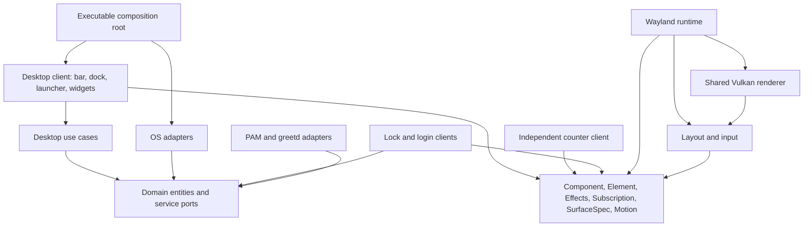

# Framework concepts and client boundaries

For a guided source-level reading, see [Follow the wiring: main to a frame](https://xandreeddev.github.io/desktop-lab/docs/execution/).
It separates construction, declarations and execution, follows `desktop_adapters()`
through the first frame and a launcher action, and records the current architecture's strengths and limits.

The framework is a small, implemented vertical stack. Clients include `lucent-desktop`, the shared `SessionScreen` used by
`lucent-lock` and `lucent-greeter`, the native `lucent-menu` picker, and the independent `hello-layer` counter. There are no empty
crates standing in for future subsystems.



| Crate | Responsibility |
| --- | --- |
| `lucent-domain` | Application IDs/commands, windows/workspaces, desktop settings, clock/date, media/system/weather snapshots, timer state; application/compositor/settings ports |
| `lucent-usecases` | Ranked app search, launch-versus-focus policy, validated widget movement, visibility, settings validation |
| `lucent-api` | Declarative elements, typed component messages, async effects, subscriptions, surface intent, animations, widget registration |
| `lucent-design` | Optional Lucent visual language: generated primitive/semantic/component tokens, named semantic palettes and wallpaper-color recipes |
| `lucent-ui` | Layout constraints, clipping, hit testing, drag threshold, text input, retained hover/focus state |
| `lucent-render` | One wgpu Vulkan device, rounded primitives, shadows, cached text/images, clipping and alpha composition |
| `lucent-wayland` | SCTK layer surfaces, seats/keyboard/pointer, callback scheduling, subscription lifetime, effect worker, bounded local IPC |
| `lucent-auth` | PAM conversations for the current account; greetd authentication and session startup |
| `lucent-services` | XDG desktop entries/icons, Hyprland Lua IPC/events, atomic settings, bounded CLI adapters for system/media/weather/wallpaper |

The API and pure domain intentionally do not depend on each other: another shell
can use the UI framework with different domain concepts. Framework code does not
know about Lucid's colors, panels, calendar or launcher. All those decisions live
in the desktop application and its optional `lucent-design` dependency. OS commands run on worker threads, never inside a
component's `view` or the Vulkan draw loop.

## Programming model and design system

Rust structs own state; traits define contracts; functions compose views and use
cases. There is no class inheritance. `view(&self, cx)` reads state and describes
an element tree; `update(&mut self, message, effects)` changes state. OS work stays
behind effects and service ports. This is a declarative view with explicit mutable
state, rather than a purely functional application.

`design/tokens.json` is the shared source for primitive palette/spacing/type,
semantic palette roles, component geometry and motion. Run
`python3 scripts/generate-design-tokens.py` after editing it. Generated Rust
constants live in `lucent-design`; CSS variables feed the Astro site. CI checks
references, types, cycles and generated drift. Native views use token references,
including structural dimensions such as `component::launcher::ROW_HEIGHT`.


The launcher, dock and bar share a spacing contract:

| Token | Logical pixels | Purpose |
| --- | --- | --- |
| `layout.unit` | 4 | Compact insets and structural token validation |
| `layout.control_step` | 8 | Tab slots and control spacing |
| `layout.shell_step` | 16 | Settled shell bounds, launcher rows, panel insets and widget anchors |
| `layout.section_gap` | 16 | Header/body/footer separation and minimum bar-group gaps |

`apps/lucent-desktop/src/shell_layout.rs` owns pure client geometry. Views and
animation targets use the same calculations. Launcher rows and input are 48
pixels high; header slots have fixed widths, and the theme cards derive their
equal widths from the actual gap. Panel height follows content, rather than an
independent handwritten total. Small viewports show fewer complete rows and
keep the selected row reachable. Dock slots have equal outer padding.

Settled panels use widths in pairs of shell cells and share a fixed grid-aligned
center. Their bottom edge uses the last grid line before the screen inset. At
resolutions that are not multiples of 16, the leftover pixels stay outside the
shell. Glyph metrics, aspect-fitted artwork, strokes and animation samples retain
their own precision; the renderer never rounds animated geometry to the grid.

Bar capsule widths derive from fixed control slots and gaps. They share the same
top and height. Optional media and clock capsules are omitted when they cannot
fit without overlap. At narrow widths, the workspace strip retains the active
workspace and shows as many neighbors as fit. Omarchy's workspace bindings remain
available for the rest.

Tests check actual painted capsules and search-field bounds, row containment,
equal gutters, grid alignment, selected-row visibility, and non-overlapping bar
and wallpaper controls. Merely using a named token is not sufficient.

`Theme::new(light)` provides `primary`, `on_primary`, `surface`,
`surface_container`, `on_surface`, `error`, `success`, `warning`, `info` and `focus`.
`Theme::button` composes a basic recipe, and `Theme::apply` supplies shared hover
color/timing, focus outlines and shadow recipes throughout a tree. Monochrome images use
`Element::tint` and `Element::contain`. Lucent's app artwork follows the same
semantic foreground; externally supplied XDG icons retain their original colors.
Contrast tests cover normal text, primary-action and error pairs in both themes.

The generic framework supplies neutral style defaults and unstyled buttons.
Clients may use a different design system without importing `lucent-design`.
The local site keeps its landing page at `/`, with `/docs/` for the engine model
and `/design-system/` for live specimens and the searchable source token catalog.

## Components and message composition

```rust
use lucent_api::*;

#[derive(Clone)]
enum Message { Increment }
struct Counter(u32);
impl Component for Counter {
    type Message = Message;
    fn view(&self, _: &ViewContext) -> Element<Message> {
        Element::row(vec![
            Element::text(format!("Count: {}", self.0)),
            Element::button("Add", Message::Increment).id("increment"),
        ]).gap(12.).padding(16.)
    }
    fn update(&mut self, _: Message, effects: &mut Effects<Message>) {
        self.0 += 1;
        effects.redraw("example");
    }
}
```

A parent can render `child.view(cx).map(ParentMessage::Child)` and delegate updates
to the child using `effects.delegate(|child_fx| child.update(message, child_fx), ParentMessage::Child)`. Delegation preserves time, redraw requests and typed async results. Mapping also lifts input, drag and slider callbacks. Stable element IDs
preserve hover and keyboard focus between views. The client owns state; the
runtime delivers messages on one UI thread. It never mutates a view tree in place.

Supported primitives: text, image, button, single-line input, slider, row, column, stack,
grid and empty shape. `Length::{Fixed, Fill, Shrink}`, padding, gaps, alignment,
absolute positioning within a stack, clipping, opacity, rounded corners and
shadows cover the implemented clients. Rich text, selection/caret editing and
IME protocols are not yet implemented. Registered font faces are chosen by index;
layout and rendering use the same font metrics.

`SliderSpec::new(value, step)` validates a normalized value in `0..=1` and a
positive finite step no greater than one; invalid input returns `None`.
`Element::slider(spec, callback)` produces a controlled input. Pointer press and
motion emit `SliderEvent { value, finished: false }`; release emits `finished:
true`, including outside the control. Arrow keys adjust by one step, Home/End
select the endpoints, and Tab moves keyboard focus. Pointer positions are
quantized to steps; the two endpoints remain reachable. Repeated keys accumulate
even before the next frame. Removing the control cancels its captured gesture.

The client stores the value in `update` and requests a redraw. It decides whether
to apply a service command continuously or on release; the slider performs no OS
operations and starts no timer or animation. `SliderStyle` supplies track, fill
and thumb geometry/colors. `lucent-design::Theme::slider` uses semantic colors
and generated component tokens. The `hello-layer` example demonstrates a demo
level independent of any audio service. It does not change system volume.

`lucent-ui` turns the track and thumb into ordinary shape paint commands, using
the same padded track geometry for pointer mapping. The existing Vulkan renderer
draws those shapes and the focus outline. Touch, accessibility announcements,
vertical sliders and a general scroll container remain unfinished.

## Effects, subscriptions and services

`Effects::task` runs a blocking operation on an ordered worker and returns a typed
message. Ordering keeps config writes from overtaking each other. Long-lived
service streams use `Subscription::stream(id, |emitter, cancellation| ...)`.
The runtime starts each stable ID once and cancels it when it disappears or the
application exits. `Subscription::every` is a convenience for bounded periodic
sources. A subscription whose parameters change must use a new ID or explicitly
react to its own configuration; a stable ID is not automatically restarted.

Runtime ingress is a shared FIFO with capacity for 64 waiting messages from
subscriptions, effect completions and local IPC. When full, background producers
wait; the UI never waits to enqueue. Each calloop dispatch handles at most 65
values before yielding to other event sources. This bounds queued message count,
not payload bytes or execution time; it does not promise fairness between producers.
Subscription emitters must not hold locks that the UI needs. Cancellation releases
an overloaded sender. A queued subscription event carries its lifetime token and
is discarded before update if that stream was removed, including an older stream
which used the same ID. Effect results already entering delivery are not retracted;
clients retain their own request/transaction identity checks.

At most 64 subscription bodies may be live, including cancelled streams which
have not yet returned. A slot is released on normal return or panic. Duplicate IDs,
thread-spawn errors and worker exhaustion fail explicitly; the runtime does not
silently skip required streams. Drop cancels registered subscriptions even when the
runtime returns through an error path. Cooperative bodies still need to respect
their token. Completed streams keep their identity until removed; this is not an
automatic service-reconnection policy. An overloaded sender checks runtime shutdown
every five milliseconds; ordinary idle delivery adds no polling loop.

The compositor adapter subscribes to Hyprland's event socket and queries fresh
snapshots on relevant events, reconnecting after disconnection. Clock, system,
media and weather adapters currently poll at 1 second, 5 seconds, 2 seconds and
15 minutes respectively. Components invalidate only surfaces whose visible data
changed. These CLI adapters are intentionally an initial implementation; native
D-Bus service subscriptions and device-control ports can replace them without
moving OS work into views.

XDG `Exec` is parsed into an executable and argument array, including supported
field codes. It is never evaluated by a shell. Application launching and dock
focus policy are tested using mock application/compositor ports. Invalid desktop
entries, unsupported field codes and unsupported settings versions fail explicitly.

## Surfaces and input

`Application::surfaces()` declares each surface's stable ID, layer, anchor, size,
exclusive zone, keyboard interactivity, visibility and full-input-capture intent.
The runtime reconciles these declarations and keeps native handles private.

The desktop uses four persistent native surfaces plus on-demand notification and feedback surfaces:

- A background painting the selected wallpaper.
- A top bar reserving 48 logical pixels (the token-defined 16-pixel inset plus 32-pixel capsules).
- A bottom-layer widget host with input regions matching interactive widgets.
- A dock host switching from the top layer to an exclusive-keyboard overlay while
  the launcher is open. Clicking outside closes it; otherwise transparent areas
  pass through to applications.

Notification toasts/history use an overlay with bounded cards and action hit regions. The secure locker uses a different Wayland role: one `ext-session-lock` surface per output, including hotplugged displays.

Dragging reports displacement from the original press in the stationary surface's
coordinates. The use case clamps placement and saves only on release. A five-pixel
threshold prevents a drag from launching an app or activating a button.

The current backend targets one compositor-selected output and supports integer
buffer scaling. Output selection, fractional scaling, touch and xdg-shell windows
are not implemented. A compositor-closed layer currently ends the client.

## Animation and rendering

`Motion` is an interruptible cubic Bézier timeline. Retargeting starts from the
current interpolated value. The desktop's spatial curve is `[0.38, 1.21, 0.22, 1]`:
500 ms for dock/panel geometry and wallpaper selection. App selection is immediate.
Content enters over 320 ms and leaves over 190 ms using `[0.05, 0.7, 0.1, 1]`.
These values were inspected in the pinned Lucid reference.

A client reports active motion through `Application::animating(surface, now)`.
The framework merges invalidations while a compositor frame callback is pending,
then renders only when needed. Hover animations use the same scheduler. No
permanent animation timer repaints the screen. Multiple surfaces share one Vulkan
device, pipeline and bounded resource cache. Text is rasterized when content,
font face, size or scale changes, then positioned with GPU geometry during motion.
Shared kerning-aware logical advances keep layout, caret placement and text
rasterization consistent. Glyph coverage is sampled at twice the physical output
density and area-resolved once, then cached at output resolution. Text origins
snap to physical pixels; shapes continue moving at subpixel coordinates. The full
framebuffer is not supersampled. Complex-script shaping and IME remain open.

`Canvas::paint` returns `Result<(), Error>`. Renderer-owned validation checks output
extents, finite scene geometry, image dimensions and instance/clip buffer sizes
against the requested device's limits. Clips also obey the storage-binding limit
and the exact integer range of their f32 indices. Geometric buffer growth falls
back to an exact fit when rounding up would exceed a valid device limit.

Scene admission uses a finite 2²⁴ envelope for coordinates, effects and color
components, with nonnegative dimensions. Nonempty text requires a font and a
positive finite normal size; each text primitive is limited to 64 KiB of UTF-8.
Text masks retain their existing 4096×1024 physical-pixel cap and 2× coverage
supersampling. Before rasterization, glyph bitmaps must fit an 8192-pixel edge
and 16,777,216 pixels. These are renderer validity limits, not desktop design
tokens, typography choices or a total memory budget.

The renderer reserves packed scene buffers fallibly and prepares all resources
before updating geometry buffers or submitting a frame. A preparation error
retains the canvas's previous resources and target pixels. Temporary uploads
lose their preparation references and become eligible for normal cache eviction;
active resources on other canvases remain pinned. A subsequent valid scene can
render on the same canvas. The native runtime still treats a rendering error as
fatal and uses its existing supervision; it does not automatically continue
displaying an old scene. Device-memory exhaustion, font parsing and upstream
layout validation remain separate concerns.

Source icons prefer SVG or high-resolution theme assets (128 px app icons,
256 px line symbols). Wallpaper previews use up to 1024 px per edge and Lanczos
resampling of premultiplied pixels; small originals are not enlarged. GPU image
textures include mip levels with trilinear sampling. Transparent edges stay
premultiplied throughout filtering and blending. These are quality/resource
budgets, separate from logical design dimensions. Source assets are prepared for
the current components at up to 2× density, not arbitrary unlimited zoom.

`ImageData::from_rgba` validates dimensions and creates immutable premultiplied
pixels and all mip levels on the asset worker. Clones share storage. The renderer
uploads prepared levels on a miss; it no longer clones, premultiplies or downsamples
image pixels during paint. `pixels()` returns premultiplied RGBA, which adapters
must account for when extracting colors.

Each Canvas retains the textures for its current scene. A redraw on another
surface cannot evict those active resources. The cache removes unused resources
in least-recently-used order above 1024 entries or 64 MiB of texture payload.
Active resources can exceed this reuse budget. `Gpu::cache_stats()` and the
inspection IPC expose active/total payload bytes, hits, misses and evictions.
CPU prepared images, framebuffers and driver allocations are separate from these
counts. Text rasterization still occurs synchronously on a text-cache miss.

Primitive and rounded-clip coverage explicitly use WGSL `fwidthFine`. The
unsuffixed derivative permits either fine or coarse evaluation, so using it for
coverage can produce different alpha at the same corner on different drivers.
See the [WGSL derivative definitions](https://www.w3.org/TR/WGSL/#derivative-builtin-functions).
The renderer chooses the sampling rule; no desktop policy or token belongs in
that calculation. A focused GPU fixture checks mirrored edge coverage at 1×/2×,
both pixel-quad phases and rounded ancestor clipping. Visual baselines retain
their existing pixel tolerances.

## IPC transport lifetime

The runtime holds its command server in an owned guard declared after the
application instance lock. Normal return, early errors and unwinding drop the
guard: cancel delivery, wake the transport's I/O loop, join its worker and remove
its recorded socket file if that path still has the same device/inode. Cleanup
therefore happens before the instance lock is released. A missing or replaced
socket path cannot prevent the worker from waking; shutdown uses calloop's poller
notifier rather than opening another connection to the pathname.

This is a separate sleeping I/O loop, not a second application-state owner. It
forwards commands into the same bounded UI queue. Its producer cancellation token
releases an overloaded send before joining; pending replies also observe shutdown.
Connected reads/writes use absolute one-second deadlines and short cancellation
checks. A slow byte stream cannot repeatedly extend the timeout. The command
limit remains 4096 bytes and the response wait remains three seconds. A ready
reply gets one bounded write even during shutdown so `quit` can acknowledge the
command that caused the exit.

The idle listener has no periodic polling timer. Filesystem cleanup is best-effort
and identity-checked; it does not guarantee recovery from arbitrary filesystem
failures or same-user interference. Runtime error paths are covered through owned
transport scope tests; native Wayland/driver fault injection remains separate.

## Frame profiling

The runtime reads `LUCENT_PROFILE_FRAMES=1` at startup. Profiling is off by default
and adds no timers or redraw requests. When enabled, `lucent-cli inspect` includes
up to 120 successful frame samples per surface. Failed or deferred presentations
are not included. The public component and domain APIs do not change.

A sample separates client `view`, framework `layout`, native `input` region work,
surface `configure` and buffer `acquire`, renderer `prepare`, command `encode`,
queue `submit`, buffer `present`, resource `retire`, and runtime `bookkeeping`.
These are CPU wall-clock durations: driver calls can block. They do not measure
GPU execution or when pixels reach the display. Text rasterization and texture
upload are nested breakdowns within `prepare`, not additional stages to add to it.
Cache misses and uploaded texture payload explain resource work on each frame.

From the prepared host, run `python3 vm/measure-framework.py --seconds 120 --profile`.
The harness creates its own temporary systemd runtime override, restarts only
Lucent, records startup and cold/warm launcher samples, then removes the override
and restarts the original configuration even after failure. It also restores the
prior stay-awake state. The guest must already be unlocked. Results remain in
`reports/local` for review. Inspection and profiling can affect the workload;
compare them with the normal-mode idle and submission-interval reports.

Memory evidence separates two Linux `smaps_rollup` snapshots (RSS/PSS and mapping
categories) from known payload counts. Prepared image bytes cover only unique
images referenced by current scenes, excluding application asset caches. Geometry
buffers report requested bytes. Surface color bytes describe one buffer per
surface, not the driver's unknown allocation count. Texture counters exclude
framebuffers and driver overhead. These numbers neither sum to total GPU memory
nor explain every resident allocation.

## Widget registration

`WidgetRegistry<Client, Message>` maps stable widget IDs and descriptors to view
functions. Duplicate IDs are rejected. The desktop uses one catalog for selector
metadata, IPC validation, token geometry and seven compiled view functions. Its
small registry is rebuilt for the current borrowed view context and retains no
snapshots or adapters. The widget host owns transient interaction state and
persists positions/visibility by ID. The framework contains no built-in widget
list. Registry views are stateless; a client stores their state or composes child
`Component`s when local state is useful. Dynamic plugin loading is deferred.

## Extension boundaries

A new desktop design can reuse `lucent-api`, `lucent-ui`, `lucent-render` and
`lucent-wayland` without importing the desktop client. A new compositor adapter
implements the domain port and event stream. New OS services should expose typed
results and subscription messages; add a port when a use case needs one, rather
than creating interfaces without an implemented consumer.

The renderer and runtime remain replaceable implementations, not public raw-handle
APIs. The session client renders our lock and login UI through the same framework.
The secure lock runtime uses `ext-session-lock-v1`; PAM verifies the session
account, and greetd owns login authentication and session creation. An ordinary
layer surface is never treated as a secure lock screen.

## Keyboard state and visual regression checks

Framework interaction distinguishes pointer hover, keyboard focus and controlled
selection. Buttons support Tab / Shift+Tab traversal and Enter / Space activation.
`Element::selected(bool)` renders a persistent selected outline; `focus_within()`
lets a composite input field draw the focus outline around all its contents.
`tab_stop(false)` lets composite clients own keyboard navigation. `Theme::apply`
provides semantic focus color, outline width and caret width. Text, placeholder
and caret share the renderer's line metrics. A long input scrolls to keep its
end caret visible. General caret movement and IME are still future work.

The launcher owns Tab / Shift+Tab to cycle Apps → Commands → Wallpapers → Themes
→ Widgets. Arrows change selection, Enter activates it, Escape closes. This is
independent from pointer hover. Its app-list height is derived from visible rows,
header, search field and spacing, so seven rows fit after scrolling. Widget
switches use `Theme::switch_indicator`, drawn from tokens without font glyphs.

Shell icons use pinned Material Symbols Rounded SVGs (Apache-2.0), with sources,
license and checksums under `lucent-services/assets/material`. The notification
bell is an original MIT-licensed Lucent drawing in the same directory. The native icon
box preserves aspect ratio; 256 px sources and mip filtering support 1× and 2×.

`visual_tests.rs` exercises the actual client through the same `Layout`, `Paint`
and Vulkan `Canvas` used by Wayland presentation. `Gpu::headless` removes the
compositor requirement, not the renderer. Fixed application data, bundled fonts,
viewport and animation times make the fixtures repeatable. Sixty PNG baselines
cover dark/light, 1×/2×, all five sections, a narrow launcher, scrolling, empty
results, long input, an opening frame, notifications/history and lock/login UI. Geometry and keyboard tests separately
assert behavior so accepting an image cannot hide a clipped row.

```sh
# Host with a Vulkan driver (Mesa lavapipe recommended)
cargo test --manifest-path lucent/Cargo.toml -p lucent-desktop visual_regressions -- --ignored
# Or use the prepared VM's software Vulkan driver; no desktop changes
python3 vm/test-visual.py
# Real keyboard events in the unlocked VM
python3 vm/test-launcher.py
```

CI installs Mesa Vulkan, selects lavapipe and runs the snapshots explicitly.
Normal workspace tests skip GPU tests. CI also runs focused texture-residency,
rounded-clipping and parameterized-shadow pixel tests. Differences above 8/255 in any
channel count as changed; more than 0.1% changed pixels overall or 1% in any
64×64 tile fails the case, so a missing small icon cannot hide in the background. Missing
images or dimensions also fail. Actual and difference images plus an HTML report
are written to `reports/local/visual-tests/` and uploaded as a CI artifact.
The threshold allows small driver rasterization differences; it is not a claim
that all renderers are pixel-identical.

For intentional design changes, run `python3 vm/test-visual.py --update` (or set
`LUCENT_UPDATE_GOLDENS=1` for the native cargo command), inspect every changed
baseline and the geometry tests, then commit the PNGs. Never update baselines just
to silence a failure. The design-system website shows representative native
captures, while its interactive browser examples remain illustrations.

## Rounded spacing, app icons and spatial alignment

`Padding { horizontal, vertical }` keeps content insets independent per axis.
`padding(v)` remains shorthand for equal insets; `padding_xy(x, y)` supports
capsules with generous ends and compact height. Measurement, placement and fill
constraints share those insets. The outer background and hit rectangle do not
shrink. The Lucent recipes use 20×8 for text buttons, 16×8 for launcher rows and
search, and 12×4 for bar capsules. Command icons and text use `Align::Center`.

`design/app-icons.json` owns 58 original MIT-licensed pictograms and exact desktop
ID aliases. `scripts/generate-app-icons.py` combines their vector artwork with
`app_icon.*` geometry tokens, emitting SVGs and a typed `AppIcon` catalog in
`lucent-design`. White alpha artwork receives the semantic foreground tint at
paint time on a transparent background, so theme changes require no rasterization.
Desktop effects rasterize the selected asset once; launcher and dock views
reference the same cached image by app ID. Unknown IDs use XDG icons,
then the generic Lucent glyph. Display names and arbitrary substring matching do
not select icons. Shell controls still use the separately licensed Material set.

Widget drag messages retain continuous coordinates until release. The release
use case snaps to `component.widget_layout.grid_step`, an alias of `space.lg`
(16 logical pixels), then clamps to the usable output. Saved and default anchors
use the grid; existing saved placements are retained until moved. Widgets keep
their own dimensions and do not avoid overlaps automatically. While a drag is
active, the desktop composes decorative grid lines behind the widgets using the
existing Element API. The spacing and line appearance use shared tokens. Lines
have no input handlers, so they never capture pointer events; there is no grid
special case in the renderer, layout engine or Wayland runtime.

`component.window.radius` references `radius.panel` (20 logical pixels). The token
generator also writes `configs/lucent/window-rules.lua`. Activation places that
compositor decoration default in a backed-up, managed block in user
`looknfeel.lua`; rollback removes only the block. Hyprland owns ordinary
application corners, including Chrome and terminals; no per-app class list is
needed. Re-run the token
generator and activation after changing this token. No packaged Omarchy file is
modified; fullscreen/no-gap compositor policies may still override decorations.

The same generated block maps `component.window.gap_out` to Hyprland's outside
margin (16 logical pixels) and `gap_in` to each side of an internal split (8).
The bar reserves only its top inset plus capsule height (16 + 32 = 48).
Hyprland adds the outside gap once, placing a normal tiled window's outer border
at y=64 and x=16. Client content begins inside its compositor border. Keeping the
bar's reservation free of bottom padding avoids adding the same gap twice.


## Dependency injection and protocol boundaries

Names distinguish contracts from implementations: domain service contracts use the `Port` suffix,
while supplied implementations are adapters. `desktop_adapters()` constructs
`DesktopAdapters`, stored as `Desktop::adapters`. Each field is typed by its
port contract. Client `ports.rs` retains only the presentation asset contract;
`adapters.rs` contains injected bindings and the cancellation adapter.

`Desktop::new(DesktopAdapters)` receives trait objects for applications, compositor,
settings, clock, system sampling, audio, media, weather, wallpapers, session locking,
notifications and presentation assets. `platform.rs` is the composition root that
chooses concrete adapters. `desktop.rs`, `views.rs`, `widgets/` and the notification
component contain no platform commands or concrete service selection. Test adapters
can exercise the same component updates without inspecting or modifying the host.

The compositor port's subscription uses a domain callback and `StopSignal`, with no
framework `Message`, `Emitter` or cancellation type crossing into the adapter.
Presentation assets are deliberately a client-level port because pixel data is not
a pure desktop-domain concept. Framework crates do not depend on the domain,
Lucent's visual theme, service adapters or authentication adapters.

This is a practical ports-and-adapters structure, not a claim of a finished framework.
The launcher owns private interaction and motion state; `widgets::Host` owns
drag origins, calendar navigation and timer behavior. Both borrow explicit inputs
and return typed intents for shared root operations. Audio/media use CLI adapters and polling;
layout has no general scroll container or complex-script shaping. OS operations
stay behind ports, while pure search, launch/focus, positioning and notification
expiry policy live in `lucent-usecases`. Architecture dependency checks enforce
these boundaries in CI.

## Launcher composition

`launcher::Launcher` privately owns open/mode/query/results/selection/scroll and
panel motion. `launcher::View` borrows that state, current domain snapshots and
already-decoded `Artwork`. It builds the five-mode selector without importing
`Desktop`, its adapter bundle, or production implementations. The desktop maps its
element handlers through `Message::Launcher` and delegates child effects.

Child updates accept current `Input` and client `Geometry`; they return optional
typed `Intent` values such as Launch, Palette or ToggleWidget. The root coordinates
shared settings, appearance transactions and application-port effects. Search
ranking remains a pure use case. This child has no event loop and is not another
`Application` implementation; the root calls it on the framework's UI thread.
There is no need to store copies of the desktop or add a framework dependency on
desktop concepts just to compose borrowed inputs.

Discovery refresh preserves an active query and removes stale result indices.
Resize and preference changes clamp selection/scroll before painting. Keyboard
routing is scoped to the open dock surface; online wallpaper input retains its
own browser state. Dock/launcher shape motion stays in the child, while wallpaper
carousel motion remains with appearance coordination. `Motion::value` now returns
its exact starting value at/before the start timestamp, preventing the inverse
curve approximation from introducing a discontinuity when a transition reverses.
This does not establish a frame-pacing or memory improvement.

## Notifications and secure session UI

Notification protocol queues belong to the adapter. It admits at most 256 queued
close/action signals and drains at most that many into one in-flight batch;
concurrent producers can fill the next queue while that batch sends. This is
separate from the pure inbox's 64 active/100 history limits, zbus buffers and the
runtime's message queue. It is not a total process-memory bound.

Admission happens under the inbox mutex before any state changes. Notify reserves
capacity for its worst-case eviction; close/dismiss need one slot, and an action
on a nonresident notification needs two. Overload returns D-Bus LimitsExceeded or
DomainError::Unavailable without changing the notification, its revision or ID
allocation. Producers never wait for queue space while holding the inbox lock.
Timeout processing closes only as many notifications as available signal capacity
permits; remaining expired entries are processed after delivery drains.

The adapter refuses to replace an existing notification server and does not allow
its own bus name to be replaced. Activation, not the adapter, owns shell switching.
After a competing owner releases the name, the normal retry can acquire it.
The watch loop observes a closed connection even when no signal is pending. It
reports unavailability and reacquires the notification name on a new connection.
In-memory inbox/history remain, while queued signals from the ended connection
are discarded; delivery across disconnection is best effort, not durable or
exactly once. Offline actions return an error. The existing 100 ms watch interval
and two-second failed-connection backoff remain; no idle CPU improvement is claimed.

Four protocol tests own private D-Bus daemons: normal protocol/actions, a stalled
subscriber with saturation/recovery, idle daemon termination/restart at the same
address, and exclusive name ownership without displacing another server. Pure adapter tests cover two-signal admission, deferred expiration
and connection cleanup. `vm/test-notifications.py` separately exercises native
action/dismiss clicks, replacement and timeout, using transient fixtures only;
it does not restart the guest bus. History must be closed before that check.

`NotificationInbox` owns replacement IDs, timeout policy, bounded active/history
storage and DND. `FreedesktopNotifications` implements the standard D-Bus methods
and action/close signals. `Center` is a framework component composed into `Desktop`
with `Element::map` and `Effects::delegate`; it renders Vulkan cards, history pages,
DND, dismissal and application actions. History is in memory. Markup, image hints,
inline replies, sound and Omarchy-specific executable hints are not advertised.
Applications using standard action signals work without shell evaluation.

Native integration stops the stock shell and its restart supervisor after checking
rendered surfaces. The native notification adapter then owns the standard bus name.
Systemd restarts Lucent after failures. Explicit rollback restores the stock
integration; stopping the desktop does not secretly start another visual shell.
Permission dialogs use libpolkit-agent with the same native `SessionScreen`.

`SessionScreen` is a separate framework client with an injected
`AuthenticationPort`. `PamLocker` authenticates the current UID through the installed
`omarchy-lock-password` PAM policy and performs account checks. `Greetd` relays the
full visible/secret/information/error conversation to greetd and asks it to launch
`start-hyprland` only after success. Authentication and session management are
provided by PAM/greetd; Lucent supplies the presentation.

`run_locked` uses SCTK's secure session-lock protocol, covers every output and waits
for the compositor's acknowledgement before any authenticated unlock. An ordinary
exit or renderer failure never sends unlock. There is no lock/greeter command or
inspect socket. Owned authentication response buffers are scrubbed; only masked bullets enter the scene
and texture cache. The renderer remains the shared Lucent/wgpu Vulkan renderer.

Launcher selection is intentionally immediate: one selected row owns both fill
and outline. Dock/panel geometry retains its timed motion. Selection no longer
uses a separate 350 ms moving background.

Lock integration adds two commands in `~/.local/lib/lucent/bin`, referenced by
managed user Hyprland/PATH blocks. They route ordinary idle and pre-sleep requests
to the native service while Lucent is active, with compositor-lock acknowledgement
and a bounded deadline. Original `/usr/bin/omarchy-system-*lock` commands remain
the fallback; no packaged file or PAM policy is changed. Rollback removes the
managed startup, shortcut and PATH blocks.


Session wallpaper is a presentation dependency: `SessionAssets` returns decoded
pixels, and the executable selects the file adapter. `SessionScreen` requests it
through an effect after startup, then draws an `Element::image(...).cover()` behind
the authentication card. `ImageFit::{Fill, Contain, Cover}` belongs to the framework;
cover preserves aspect ratio and clips a centered image to its layout box. An
opaque base remains even when decoding fails. A user path unit synchronizes the
login copy, so the greeter never needs access to the desktop account's home.


Online wallpaper search is a native client of `WallpaperCatalogPort`; its
`OnlineWallpapers` adapter owns HTTP, provider parsing and cache paths. The browser
uses a generation-keyed subscription, independently of the ordered effect worker.
`PaletteGenerationPort` supplies a dominant RGB seed, and the design crate maps
that seed to validated semantic roles. `ThemePort` accepts the complete selected
palette; application export and lock/login receive those same values. The generic
framework has no wallpaper/provider/palette policy.


Wallpaper selection uses a dedicated presentation coordinator (`wallpaper_selection.rs`).
A ticket is reserved at user intent, before HTTP finishes. The coordinator stages a
bounded immutable source copy through `WallpaperPort`, decodes through `AssetPort`,
and optionally samples through `PaletteGenerationPort`. Only successfully prepared
assets reach `commit`. A stale or failed preparation is discarded; one latest pending
choice coalesces bursts of input. Once accepted, a commit finishes before the next
choice starts. Its result carries the prepared image, avoiding a fallible second
background decode after changing the selected path.

`WallpaperAsset` is a domain data record with original-source provenance and a staged
path, not proof of validity. The filesystem adapter verifies ownership and metadata.
Selection links change by rename; this provides atomic visibility, not power-loss
durability or a transaction across wallpaper, palette settings, app exports and login
publication. The latter exports remain ordered, eventual operations with visible errors.
The appearance queue is reserved for this coordinator; an ambiguous worker failure
exits the native client and supervision reloads actual persisted state. The selected
snapshot survives original-file edits. The store retains eight snapshots, preserves
the selected one during pruning, and never removes source files. SVG sources must be
self-contained. A legacy selection migrates on the next explicit choice.

`palette_intent.rs` separates explicit color intent from automatic wallpaper colors.
A later manual choice wins; extraction results also match the current asset. Small
previews copy only prepared mip levels via `ImageData::downsample`, so retaining a
preview does not retain its full-resolution background allocation. No provider,
selection or color policy enters the generic renderer.


`Date` and `Placement` now enforce demonstrated domain invariants through private
storage. `Date::new(year, month, day)` validates Gregorian dates and derives weekdays;
`month_start(offset)` performs constant-time checked month arithmetic. No OS clock,
chrono or renderer dependency enters the domain. The service adapter converts its
already-valid calendar date; tests compare weekdays with chrono across positive and
negative leap-year cycles.

`Placement::new(x, y)` and Serde deserialization reject non-finite values while
retaining the existing `{ "x": ..., "y": ... }` settings representation. Negative
coordinates are valid domain values. The client still supplies grid tokens and
output/widget bounds. `snap_placement` uses wider intermediates and rejects an
unrepresentable result; `move_widget` validates dimensions before mutation. An invalid
finished drag clears its temporary origin/grid and leaves the last valid position
unchanged. LauncherSize and LaunchCommand remain records with boundary validation;
these changes do not imply that every domain record is a validated value object.


## Widget composition

`widgets::Host` privately owns drag origins, calendar navigation and the focus
timer. Its update borrows `DesktopSettings` rather than storing another copy.
`widgets::View` borrows clock/system/media/weather snapshots and prepared Artwork;
no widget reads `Desktop` or selects an adapter. The root maps its element messages
and delegates effects using the same framework API as the launcher.

One `widgets::catalog::WIDGETS` entry supplies ID, title, description, token size,
default placement and view function. Selector choices, IPC validation and widget
rendering use that table. Add a compiled view and a catalog entry to extend it;
there is no dynamic plugin loader.

Dragging changes the in-memory position continuously. Release snaps/clamps and
returns `Intent::Save`; the root queues its settings adapter. Hiding a widget clears
its drag, and unknown/hidden IDs cannot mutate positions. Invalid geometry returns
an error and clears transient state without requesting persistence. Notes also
return Save; media buttons return an action intent. The root retains adapter
ownership, and the renderer receives only generic elements.


## Preference persistence

The desktop's persistence child receives its adapter through `SettingsPort`.
Requests carry monotonically checked revisions and immutable snapshots. Only one
settings task is outstanding; edits during that task replace the pending snapshot.
After its completion, the newest pending revision runs. A 1,000-edit unit fixture
therefore writes only the first accepted and final requested values.

Save failures belong to this child. An unrelated `Message::Completed(Ok(()))`
cannot clear them. Worker rejection or panic marks the active save failed;
explicit retry or a newer edit can attempt the retained snapshot again. Matching
completion updates acknowledged state and clears the error only on success.
Notes borrow unavailable/saving/retrying/saved/failed status and return a retry
intent. The root invokes persistence; widget presentation never calls its adapter.

`lucent-cli settings retry` retries a failed save. Inspection exposes
`settings_save_status` and `settings_save_error`. Waiting for saved state is required
before terminating the process if the latest edits must survive. This does not add
shutdown flushing, cross-process writer arbitration or fsync/power-loss durability.
The existing adapter validates settings and replaces the file through rename.

Widget dragging still changes the shared aggregate while the gesture is in
progress. Its own save waits for release, but another preference change can include
that intermediate position. Separating preview placement from committed state is
tracked as follow-up widget work.
